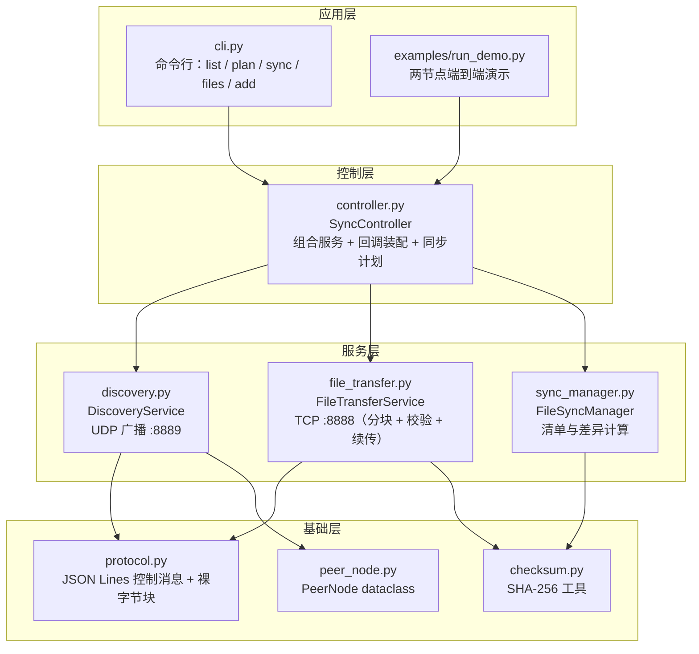

[](https://github.com/ffgxfvy/p2p-file-sync/actions/workflows/ci.yml)
[](#测试)
[](pyproject.toml)
[](LICENSE)

# P2Psync — 局域网 P2P 文件同步

> **UDP 广播做节点发现 + TCP 做可靠传输**，纯 Python 标准库实现，无需中心服务器。
> 带 **SHA-256 完整性校验**与**断点续传**，90 个测试覆盖（含两个节点互传的端到端场景）。

```text
- 1. A 准备共享文件
   data.bin       204800 字节  sha256=8c6627e25bfb…
   readme.txt         23 字节  sha256=aea0ba042df4…
- 2. B 发现 A 并计算同步计划
   发现节点：node-A@127.0.0.1:37755 [在线]
   需下载 2 个：data.bin, readme.txt
- 3. B 执行同步
   ✓ data.bin → data.bin
   ✓ readme.txt → readme.txt
- 4. 校验：两端内容逐字节一致
   readme.txt   一致  aea0ba042df4e2b6…
   data.bin     一致  8c6627e25bfbdef2…
- 5. 再同步一次（应无事可做）
   计划：内容一致 2 个，跳过：data.bin, readme.txt
```

上面是 `python examples/run_demo.py` 的真实输出——不需要第二台设备，在本机起两个节点就能验证全流程。

## 架构



**为什么用两层协议**：

| 需求 | 协议 | 原因 |
|---|---|---|
| 找到局域网里的同伴 | **UDP 广播**（:8889） | 开销小、无需建连、天然"一发布多接收" |
| 传输文件内容 | **TCP**（:8888） | 需要可靠、有序、有流控的字节流 |
| 交换文件清单 | TCP + **JSON Lines** | 结构化、可读，`nc` 都能看懂对端在说什么 |

## v2 相对课程版本（v1）的四处实质改进

| # | 问题（v1） | 改进（v2） | 对应测试 |
|---|---|---|---|
| 1 | 只比"大小 + 修改时间"，**内容不同但大小相同会被漏判** | 改用 **SHA-256** 作为权威判据，并保留按 `size`+`mtime` 的哈希缓存以避免重复读盘 | `test_plan_downloads_when_hash_differs_even_if_size_matches` |
| 2 | 中断后从头重传，可能留下**损坏的半截文件** | **断点续传**：写入 `<name>.part`，续传时以实际长度作为 `offset`；校验通过才改名为正式文件 | `test_resume_completes_a_partial_download` |
| 3 | 无校验，无法确认收到的内容正确 | 收完后校验**全量哈希**；不匹配则删除残留并抛 `ChecksumError` | `test_corrupted_part_file_fails_checksum_and_is_removed` |
| 4 | 服务端未校验文件名，存在 `../` **路径穿越**风险 | 仅允许共享目录内的普通文件，拒绝 `../`、绝对路径、含分隔符的文件名 | `test_path_traversal_is_rejected` |

另外补上了：并发传输（线程池 + 每连接一线程）、`.part` 残留文件从清单中排除、自环过滤、回调异常隔离、端口占用降级。

> v1 的原始代码完整保留在 [`legacy/`](legacy/README.md)，可以与 v2 逐文件对照。

## 快速开始

纯标准库，无需安装依赖：

```bash
git clone https://github.com/ffgxfvy/p2p-file-sync.git
cd p2p-file-sync

# 方式一：一键演示（本机起两个节点）
python examples/run_demo.py

# 方式二：交互式
python main.py -d ./shared_files -n 我的笔记本
```

交互命令：

| 命令 | 作用 |
|---|---|
| `list` | 查看已发现的设备 |
| `plan [设备名]` | **预览**同步计划（只算差异，不下载） |
| `sync [设备名]` | 与设备同步（默认对全部在线设备） |
| `files` | 查看自己的共享文件（含大小与哈希前缀） |
| `add <路径>` | 把外部文件加入共享目录 |
| `info` | 显示本节点名称 / 端口 / 共享目录 |

适合脚本化的参数：

```bash
# 定时任务：启动后立即同步一次并退出，不进入交互界面
python main.py --peers 192.168.1.7:8888 --once --wait 3

# 禁用 UDP 广播（跨网段或受管控的网络里用手动指定节点）
python main.py --peers 10.0.0.5:8888,10.0.0.6:8888 --no-broadcast
```

**在两台设备上各跑一次 `python main.py`**，即可互相发现并同步。

## 测试

```bash
pip install -e . -r requirements-dev.txt
pytest tests -v            # 90 个测试
```

| 测试文件 | 覆盖内容 |
|---|---|
| `test_checksum.py` | SHA-256 已知向量、分块哈希、`verify_file` 边界 |
| `test_protocol.py` | JSON Lines 编解码、中文/emoji、精确读取与截断检测 |
| `test_sync_manager.py` | 清单、**哈希 vs 大小判据**、哈希缓存失效、计划生成与描述 |
| `test_partial_files.py` | `.part` 残留不污染清单 |
| `test_discovery.py` | 节点登记/刷新/自环过滤/回调/离线判定 |
| `test_transfer.py` | **真实 TCP**：文本/二进制/大文件（2 MB+）、Unicode 文件名、续传、篡改检测、路径穿越、服务端容错 |
| `test_controller.py` | **端到端**：两个完整节点互传、并发多文件、多服务端、续传、死节点容错 |

CI 在 **Ubuntu + Windows × Python 3.8/3.12** 四种组合上跑测试与演示脚本。

## 已知局限

| 局限 | 说明 / 改进方向 |
|---|---|
| 明文传输 | 局域网内可被嗅探；可加 TLS 或对称加密 |
| UDP 广播无法跨网段 | 需中心节点 / UDP 打洞 / DHT |
| 单向拉取语义 | 目前只从对端下载，不主动推送；`to_upload` 仅作提示 |
| 冲突处理较简单 | 同名不同内容时生成 `a (1).txt`，不做三方合并 |
| 无传输限速 | 大文件会占满带宽；可加令牌桶 |
| 发现端口固定 8889 | 被占用时降级为"只发不收" |

## 目录结构

```
p2p-file-sync/
├── p2psync/                    # v2 实现
│   ├── protocol.py                 # JSON Lines + 裸字节块
│   ├── checksum.py                 # SHA-256 工具
│   ├── peer_node.py                # 节点数据模型
│   ├── discovery.py                # UDP 广播发现
│   ├── file_transfer.py            # TCP 传输（分块 / 校验 / 续传）
│   ├── sync_manager.py             # 清单与差异计算
│   ├── controller.py               # 应用层门面
│   ├── cli.py                      # 命令行
│   └── __main__.py                 # 支持 python -m p2psync
├── tests/                      # 90 个测试
├── examples/run_demo.py        # 两节点端到端演示
├── legacy/                     # v1 课程版本（7 个文件 + 对照说明）
├── main.py                     # 入口
├── CHANGELOG.md
└── pyproject.toml
```

## 背景

《计算机网络与通信》课程小组项目（组 13），我在其中负责程序设计。v2 是我在整理作品集时做的工程化重写——把"能跑通"升级为"能验证正确性"。

## 我负责的部分

v1：程序设计、socket 通信模块、同步逻辑、CLI。
v2：协议抽象、SHA-256 校验、断点续传、并发传输、安全防护、全部测试与 CI。
